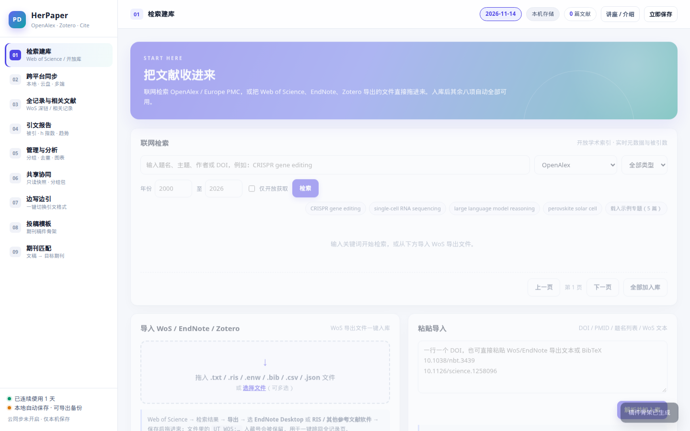
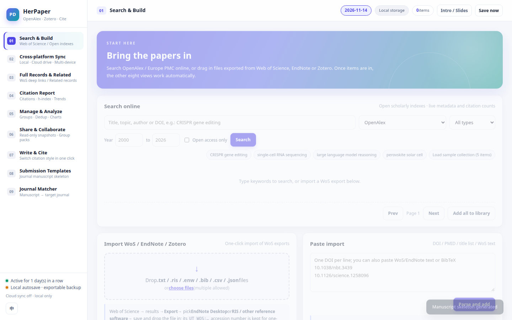

# HerPaper

**本地优先的浏览器文献工作台 · A local-first literature workbench that runs entirely in your browser.**

[在线使用 Live demo](https://fudan2026.github.io/herpaper/) · [介绍页 Intro](https://fudan2026.github.io/herpaper/promo.html) · [SuPro 内嵌版](https://supro.si/her-paper) · [English](#english)

把文献收进来、管起来、引出去：联网检索开放学术索引，导入 Web of Science / EndNote / Zotero 导出文件，边写边引一键切换 7 种引文格式，生成引文报告与投稿骨架——全程无需安装、无需账号、数据默认只存你的浏览器。

> Collect, curate, and cite: search open scholarly indexes, import WoS/EndNote/Zotero exports, write with live citation switching across 7 styles, and produce citation reports and manuscript skeletons — zero install, no account, data stays in your browser by default.



## 为什么是 HerPaper · Why HerPaper

| 你可能正在用 | HerPaper 的位置 |
|---|---|
| Web of Science | 检索免费但需要机构订阅；HerPaper 用 OpenAlex / Europe PMC / arXiv / Semantic Scholar 做**零成本等价检索**，并为每条结果保留 **WoS 全记录深链**（有订阅时一键直达） |
| Zotero / EndNote | 桌面软件更强，但上手成本高；HerPaper 是**网页打开即用**的轻量工作台，与 Zotero 通过 RIS / BibTeX / **CSL-JSON** 双向互通、增量同步互不锁定 |
| Overleaf / Word | 各自写作；HerPaper 的「边写边引」在正文中插入标记，**全文引用格式一键重排**（GB/T 7714-2015、APA 7、Vancouver、Nature、IEEE、Chicago、MLA 9），导出 Markdown / HTML / Word |
| 期刊官网选刊 | HerPaper「期刊匹配」用你的标题+摘要结合库内期刊分布**打分推荐目标期刊**，并生成对应投稿骨架 |

## 九个视图 · The nine views

| # | 视图 View | 能做什么 What it does |
|---|---|---|
| 01 | 检索建库 Search & Build | 联网检索 OpenAlex / Europe PMC / arXiv (q-fin) / Semantic Scholar / DOI 精确；拖入 `.txt .ris .enw .bib .csv .json .nbib`（WoS / EndNote / Zotero 导出）或粘贴 DOI 列表自动补全元数据 |
| 02 | 跨平台同步 Sync | 本机自动保存（默认）；**自愿开启** SuPro 云端同步（按账号 RLS 隔离）；Zotero Local API / Web API v3 增量同步；整库导出 / 恢复六种格式 |
| 03 | 全记录 Full Records | 每条文献生成 WoS 全记录深链 + 开放替代链接；OpenAlex `related_works` 相关记录；引文链条（参考文献 / 施引文献一键入库） |
| 04 | 引文报告 Citation Report | 批量刷新被引数；逐年分布、高被引 Top 10、期刊分布、h 指数、篇均被引；导出 CSV / 打印 PDF |
| 05 | 管理与分析 Manage | 分组、标签、星标、备注、去重、对比矩阵、反馈草稿导出；年度 / 期刊 / 主题 / 作者四张统计图 |
| 06 | 共享协同 Share | 只读共享快照（本地服务模式生成链接；静态模式生成自包含 HTML）；分组 RIS / BibTeX 打包导出 |
| 07 | 边写边引 Write & Cite | `[[PD:n]]` 标记插入引用，7 种样式 × 数字 / 作者-年两种正文标注实时重排；导出 Markdown / HTML / Word `.doc` |
| 08 | 投稿模板 Templates | 按目标期刊（Science、JMLR 等）生成结构化稿件骨架，自动套用该刊引文样式 |
| 09 | 期刊匹配 Matcher | 标题 + 摘要主题提取 × OpenAlex 期刊指标 × 库内期刊分布 → Top 目标期刊推荐 |

## 三种使用方式 · Three ways to run

1. **零安装（推荐）**：直接打开 <https://fudan2026.github.io/herpaper/>。库存在浏览器 localStorage，可随时导出完整 JSON 备份。
2. **本地服务模式**：`python3 serve.py`（仅标准库，无第三方依赖），访问 `http://127.0.0.1:8765`。库持久化到 `herpaper/data/state.json`，支持只读分享链接与 arXiv 代理。
3. **SuPro 内嵌**：<https://supro.si/her-paper>。同一应用原生内嵌于 SuPro 平台（非 iframe），登录 SuPro 后可自愿开启云端同步，跨设备同一库。

## 隐私与数据 · Privacy & data

- **本地优先**：默认一切数据（文献库、分组、文稿、设置）只存你的浏览器或你的本机 `data/state.json`，不上传任何服务器。
- **唯一出网流量**（仅在你主动检索/刷新时）：
  - `api.openalex.org` — 开放学术索引检索与元数据补全
  - `www.ebi.ac.uk` — Europe PMC 检索
  - `export.arxiv.org` — arXiv 检索（静态托管直连；本地服务模式走 `/api/proxy` 代理）
  - `api.semanticscholar.org` — Semantic Scholar 检索
- **自愿上云**：仅在 SuPro 内嵌、你手动开启云同步且已登录时，才会把库写入 SuPro 的 `/api/herpaper/library`（按账号 RLS 隔离）。关闭后立即回到纯本机。
- **零遥测**：没有统计脚本、没有追踪像素、没有账号要求。

## 架构 · Architecture（纯静态零构建 · zero-build static app）

```
index.html        九视图骨架（服务端零依赖）
style.css         设计令牌 + 全部样式（CSS 变量主题化）
core.js           状态持久化 / 检索适配器 / WoS·RIS·BibTeX·CSV·CSL 解析 / 引文格式化 / 导出 / 图表
integrations.js   CSL-JSON 互通 / OpenAlex 引文链 / Zotero 桥接 / 期刊模板库
cloud-sync.js     自愿开启的 SuPro 云同步（默认关闭）
herpaper-i18n.js  中文→英文显示层 i18n（英文模式自动接管全部界面文案）
app.js            九视图渲染与交互
serve.py          可选本地服务（标准库实现：/api/state、/api/share、arXiv 代理）
zotero_sync.py    命令行 Zotero 增量同步助手
promo.html        讲座 / 工作坊介绍页
tests/            node:test 零依赖测试套件（解析器、7 种引文样式、CSL 往返、i18n 覆盖审计）
```

## 开发与测试 · Develop & test

```bash
# 本地起站（任意静态服务器均可）
python3 -m http.server 8000

# 运行测试（Node ≥ 18，零依赖）
node --test tests/

# 运行单个测试文件
node --test tests/core-parsers.test.js
```

## 路线图 · Roadmap

- [x] 九视图工作台（检索 / 同步 / 全记录 / 引文报告 / 管理 / 共享 / 边写边引 / 模板 / 匹配）
- [x] Zotero 互通：RIS / BibTeX / CSL-JSON + Local API 增量同步
- [x] EN 界面 i18n（含独立模式中英切换）
- [x] 暗色模式、命令面板（Ctrl/Cmd+K）、快捷键、引文图谱
- [ ] PDF 附件与全文管理
- [ ] 引文图谱可视化增强（时间线视图）

完整变更见 [CHANGELOG.md](CHANGELOG.md)。

## 许可 · License

[MIT](LICENSE) © Fudan2026。古籍无涉；检索结果元数据版权归各数据源（CC BY / 开放数据），各自遵循其条款。

---

# English

**HerPaper is a local-first literature workbench that runs entirely in the browser — no install, no account, no server required.**

- **Search** OpenAlex, Europe PMC, arXiv (q-fin), Semantic Scholar, or resolve DOIs exactly — free equivalents of a Web of Science search, with a WoS full-record deep link preserved for every item.
- **Import** WoS / EndNote / Zotero exports (`.txt .ris .enw .bib .csv .json .nbib`) by drag & drop, or paste a DOI list and let OpenAlex backfill authors, journals, abstracts, and citation counts.
- **Write & cite**: insert `[[PD:n]]` markers and switch the whole manuscript between GB/T 7714-2015, APA 7, Vancouver, Nature, IEEE, Chicago, and MLA 9 in one click; export Markdown / HTML / Word.
- **Analyze**: citation reports (yearly distribution, top-cited, journal mix, h-index), library charts, dedup, groups, tags, and a journal matcher that scores where your manuscript fits best.
- **Interop, not lock-in**: two-way RIS / BibTeX / CSL-JSON with Zotero, incremental sync against the Zotero Local API, and self-contained HTML snapshots for read-only sharing.
- **Privacy**: everything stays in your browser by default. The only outbound traffic goes to open scholarly APIs (`api.openalex.org`, `www.ebi.ac.uk`, `export.arxiv.org`, `api.semanticscholar.org`) when you search. Cloud sync exists only as an explicit opt-in inside [SuPro](https://supro.si). Zero telemetry.

Run it at <https://fudan2026.github.io/herpaper/>, or `python3 serve.py` for the local-server mode (persistent `state.json` + share links). Tests: `node --test tests/`. MIT licensed — see [CHANGELOG.md](CHANGELOG.md) for release history.


